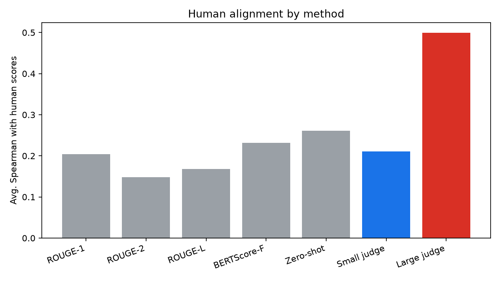
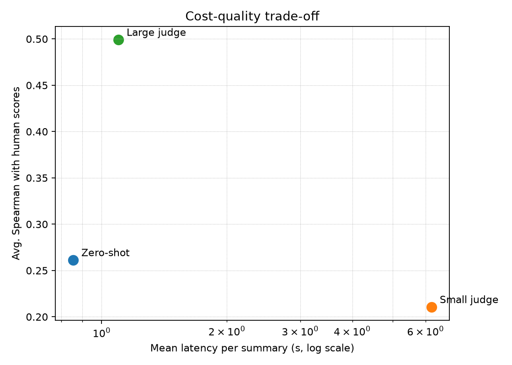

# Large vs. Small LLMs as Evaluators of Abstractive Summarization

[](#5-setup)
[](report/main.pdf)
[](LICENSE)

**Ümit Arslan** · İzmir Institute of Technology · CENG 467 Natural Language Understanding and Generation, term project (Spring 2026)

> **TL;DR** — One LLM-as-a-judge pipeline, two judges of very different size: a *small open* model (Qwen2.5-3B, run locally through Ollama) and a *large proprietary* one (Google Gemini 2.5 Flash), scoring SummEval summaries on faithfulness, coherence, relevance and fluency with an identical rubric + chain-of-thought prompt. The large judge reaches a mean Spearman correlation of **0.50** with human ratings; the small judge stops at **0.21**, statistically indistinguishable from ROUGE and BERTScore and no better than its own rubric-free zero-shot variant. A small open judge is not a drop-in replacement yet. Code, prompts, raw judge outputs and the [paper](report/main.pdf) are all in this repo.

---

## 1. What this project does

This project tests whether a **small, open LLM** can replace a **large LLM**
as an automatic *judge* for abstractive summarization quality.

The "LLM-as-a-Judge" setup is widely used because strong models align with human
quality judgments far better than ROUGE or BERTScore – but the strongest judges are
large, costly, and often closed. The core question:

> **Does swapping a large judge for a small open judge meaningfully hurt evaluation quality, and by how much?**

This is an **evaluation task**, not a generation task. The system does **not** write
summaries. It scores summaries that already exist in the SummEval benchmark and
measures how well those scores correlate with human ratings.

**Input:** `(source document, machine-generated summary, scoring rubric)`
**Output:** four numeric scores – *faithfulness, coherence, relevance, fluency* –
each preceded by a short Chain-of-Thought (CoT) justification.

---

## 2. Components

| Component | Role |
|---|---|
| **Baseline 1 – ROUGE** (ROUGE-1/2/L) | Classical n-gram overlap vs. reference summaries |
| **Baseline 2 – BERTScore** | Embedding-based semantic similarity vs. reference summaries |
| **Baseline 3 – Zero-shot Direct Scoring** | Small model, single number, *no rubric, no CoT* – isolates prompt-design effect |
| **Small Judge** | Qwen2.5-3B (local, via Ollama) + full rubric + CoT |
| **Large Judge** | Gemini 2.5 Flash (proprietary, via the Google Gemini API) + full rubric + CoT – reference judge |

All five run on the **same fixed SummEval subset** (100 articles × 8 machine summaries = 800 records) so comparisons are apples-to-apples.

> **Note on judge models.** Following the proposal's intent (a small local judge vs.
> a large proprietary one), the small judge is Qwen2.5-3B run locally via Ollama and
> the large judge is Google Gemini 2.5 Flash via the Gemini API (pay-as-you-go; a
> full 800-record run costs well under US$1). The code also ships a **Groq** backend
> (`provider: groq`, e.g. Llama-3.3-70B) as a fully free alternative large judge.

---

## 3. Key results

Average Spearman correlation with the SummEval human ratings across the four
dimensions, with 95 % bootstrap confidence intervals (1,000 resamples). Per-dimension
numbers are in [`results/correlation.csv`](results/correlation.csv) and
[`results/bootstrap.csv`](results/bootstrap.csv).

| Method | Avg. Spearman ρ | 95 % CI | Needs reference summaries? |
|---|---:|:---:|:---:|
| **Large judge** – Gemini 2.5 Flash, rubric + CoT | **0.499** | 0.459 – 0.536 | no |
| Zero-shot direct score – Qwen2.5-3B, no rubric | 0.261 | 0.212 – 0.311 | no |
| BERTScore (F1) | 0.231 | 0.185 – 0.281 | yes |
| **Small judge** – Qwen2.5-3B, rubric + CoT | **0.210** | 0.171 – 0.250 | no |
| ROUGE-1 | 0.204 | 0.156 – 0.251 | yes |
| ROUGE-L | 0.168 | 0.120 – 0.216 | yes |
| ROUGE-2 | 0.148 | 0.094 – 0.195 | yes |



**What this means**

- **The large judge works.** It beats every baseline on every dimension. Its strongest
  dimension is consistency/faithfulness (ρ = 0.62), exactly where the reference-based
  metrics are weakest (BERTScore ρ = 0.08).
- **The small judge does not.** Its confidence interval overlaps ROUGE-1 and BERTScore,
  and it is no better than the same model asked for a single number without any rubric.
  The rubric + chain-of-thought prompt helps the large model and does nothing for the small one.
- **The small judge is systematically harsh.** On faithfulness it scores summaries about
  2.5 points lower (on a 1–5 scale) than the large judge; judge–judge Pearson agreement is
  only 0.22 overall ([`results/agreement.csv`](results/agreement.csv)).
- **Cost is not the bottleneck.** The full 800-summary run cost about $0.40 on Gemini and
  ran at ~55 summaries/min; the local 3B judge was free but ~6× slower (~10 summaries/min
  on a 4 GB consumer GPU) ([`results/cost.csv`](results/cost.csv)).



The full analysis, related work and limitations are in the paper: [`report/main.pdf`](report/main.pdf).

---

## 4. Repository structure

```
llm-judge-summarization/
├── common.py             # shared config/.env loading, JSONL IO, paths, dim mapping
├── data/
│   ├── download.py       # pulls mteb/summeval from the HF Hub, prints schema
│   ├── preprocess.py     # builds the fixed, seeded subset -> subset.jsonl
│   └── subset.jsonl      # the frozen evaluation set (generated, do not edit by hand)
├── prompts/
│   ├── rubric_cot.txt    # 4-dimension rubric + CoT instruction (used by both judges)
│   └── direct_score.txt  # minimal "score this summary" prompt (Baseline 3)
├── baselines/
│   ├── rouge_baseline.py
│   ├── bertscore_baseline.py
│   └── zeroshot_direct.py
├── judge/
│   ├── pipeline.py       # shared judge loop: build prompt -> call model -> parse scores
│   ├── backend_local.py  # Qwen2.5 via Ollama (OpenAI-compatible endpoint)
│   ├── backend_api.py    # large judge: Gemini and Groq (Llama-3.3-70B) backends
│   └── parse.py          # JSON + regex fallback parser for model output
├── eval/
│   ├── correlation.py    # Spearman / Kendall-tau / Pearson vs. human scores
│   ├── agreement.py      # judge-vs-judge agreement + mean score difference
│   ├── cost.py           # tokens, latency, throughput per summary
│   ├── bootstrap.py      # bootstrap confidence intervals for correlation
│   ├── plots.py          # cost-vs-quality and correlation-bar figures
│   └── make_tables.py    # emits report/tables.tex (booktabs) from the result CSVs
├── results/              # scores (JSONL), tables (CSV) and plots from the paper's run
├── report/               # LNCS paper: main.tex, references.bib, tables.tex, main.pdf
├── docs/proposal.md      # the original topic proposal
├── config.example.yaml   # copy to config.yaml and adjust (see Configuration)
├── requirements.txt
├── LICENSE
└── README.md
```

> `data/subset.jsonl` and everything under `results/` are **committed** so the paper's
> numbers can be checked without re-running anything (every judge call's raw output is
> in the JSONL files). The subset is seeded, so re-running `preprocess.py` reproduces
> the identical file.

---

## 5. Setup

Requires **Python 3.10–3.13**.

```bash
# 1. clone
git clone https://github.com/umitarslann9/llm-judge-summarization.git
cd llm-judge-summarization

# 2. virtual environment
python -m venv .venv
source .venv/bin/activate          # Windows: .venv\Scripts\activate

# 3. dependencies
pip install -r requirements.txt
```

### Small judge – Ollama (local)

Install [Ollama](https://ollama.com/download), then pull the small model:

```bash
ollama pull qwen2.5:3b
```

Ollama serves an OpenAI-compatible API on `http://localhost:11434/v1`, which the
small judge and the zero-shot baseline use.

### Large judge – Gemini API key

Create a key at <https://aistudio.google.com/apikey> and expose it as an environment
variable, or put it in a git-ignored `.env` file at the repo root:

```bash
# .env
GEMINI_API_KEY=...
# GROQ_API_KEY=gsk_...   # optional, only if using the free Groq backend
```

Keys are **never** stored in `config.yaml`; they are read from the environment / `.env`.
Full-scale runs need the (cheap) pay-as-you-go tier; the free tier is heavily
rate-limited. To run completely free instead, set `large_judge.provider: groq` in
`config.yaml` and use a free Groq key from <https://console.groq.com>.

### Configuration

```bash
cp config.example.yaml config.yaml
```

`config.yaml` selects the models and subset size (large judge provider/model, the
local Ollama model, BERTScore device, and the seeded subset of SummEval). Defaults:
large judge `gemini-2.5-flash` (Gemini API), small judge `qwen2.5:3b` (Ollama),
100 articles × 8 summaries, seed 42.

---

## 6. How to run

The pipeline runs **stage by stage**; each stage writes to disk so later stages can
be re-run without repeating expensive work.

```bash
# Stage 1 – data (run once)
python data/download.py               # -> data/summeval_raw.jsonl
python data/preprocess.py             # -> data/subset.jsonl

# Stage 2 – cheap baselines
python baselines/rouge_baseline.py        # -> results/rouge.jsonl
python baselines/bertscore_baseline.py    # -> results/bertscore.jsonl  (CPU)

# Stage 3 – small judge + zero-shot baseline (local, via Ollama)
python baselines/zeroshot_direct.py       # -> results/zeroshot.jsonl
python judge/pipeline.py --judge small    # -> results/judge_small.jsonl

# Stage 4 – large judge (Gemini API)
python judge/pipeline.py --judge large --limit 5   # smoke test first
python judge/pipeline.py --judge large             # -> results/judge_large.jsonl

# Stage 5 – evaluation + analysis
python eval/correlation.py            # Spearman / Kendall-tau vs. human, per dimension
python eval/agreement.py              # large-vs-small agreement
python eval/cost.py                   # cost / speed table
python eval/bootstrap.py              # confidence intervals on the correlations
python eval/plots.py                  # figures for the report
python eval/make_tables.py            # report/tables.tex from the result CSVs
```

**Tip:** every model script accepts `--limit N` to run on the first N records, and
the judges/zero-shot accept `--overwrite` to ignore existing output and start fresh.
Long runs write after every record and **resume** automatically if interrupted.

---

## 7. Reproducibility notes

- The SummEval subset is selected with a **fixed seed** (`config.yaml -> subset.seed`),
  so every run evaluates identical inputs.
- All decoding uses **temperature 0** for deterministic scores.
- All prompts are committed under `prompts/` – judge behavior is fully traceable.
- The judge model name is recorded in every `results/judge_*.jsonl` row.
- The judge's *faithfulness* dimension is mapped to SummEval's *consistency* for
  correlation; the other three dimension names align directly.

---

## 8. Known risks / open issues

- **API limits / cost** – the large judge uses the Gemini API; a client-side rate
  limiter (`rpm_limit`) keeps requests under the cap. The free tier is heavily
  rate-limited, so full runs use the (very cheap) pay-as-you-go tier; a free Groq
  backend is provided as an alternative (`provider: groq`).
- **Malformed small-model output** – handled by JSON-first parsing with a regex
  fallback and limited re-queries (see `judge/parse.py`).
- **Noisy correlation on a modest subset** – addressed with bootstrap confidence
  intervals (`eval/bootstrap.py`).
- **Long source articles** – lightly truncated to fit the small model's context.

---

## 9. Report

The scientific write-up (LNCS format) lives in `report/`. Result tables are generated
automatically from the result CSVs by `eval/make_tables.py` (into `report/tables.tex`,
which `main.tex` `\input`s), so the numbers in the paper match the computed results
exactly.

---

## 10. Citation

```bibtex
@misc{arslan2026llmjudge,
  author = {Arslan, {\"U}mit},
  title  = {Large vs. Small {LLMs} as Evaluators of Abstractive Summarization},
  year   = {2026},
  note   = {CENG 467 term project, {\.I}zmir Institute of Technology},
  url    = {https://github.com/umitarslann9/llm-judge-summarization}
}
```

## 11. License

[MIT](LICENSE) © 2026 Ümit Arslan. SummEval data is used under its own license via the `mteb/summeval` dataset on the Hugging Face Hub.
